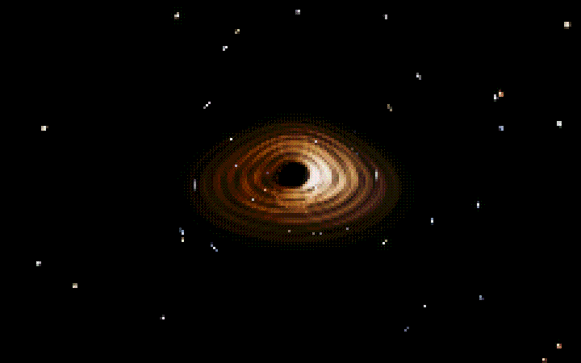
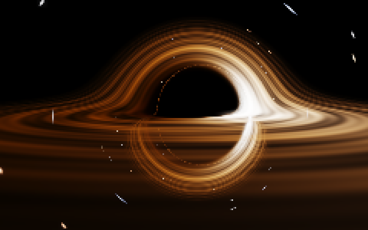
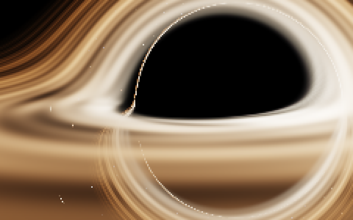
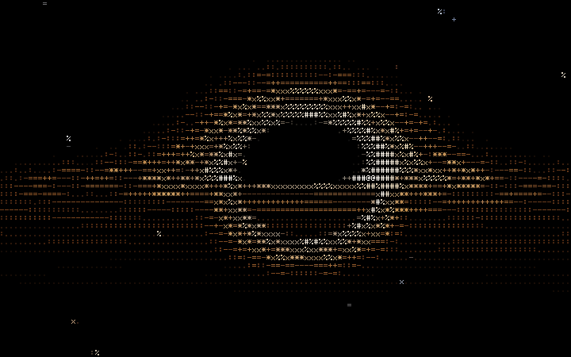

# black-hole-ascii

> **Real-Time 4D Kerr-Schild Relativistic Black Hole Simulator in Pure Rust**  
> *Rendered directly in your terminal using 24-bit TrueColor ANSI Half-Block & ASCII Geodesic Raymarching — 100% CPU, zero GPU dependencies.*

[](https://www.rust-lang.org)
[](https://github.com/PedroSmaxY/black-hole-ascii/releases)
[](LICENSE)
[]()
[]()

---

## Visual Showcase

<p align="center">
  
  <br />
  <em>Startup Intro Dive and Zen Mode autopilot in 24-bit TrueColor Half-Block mode (<code>▀</code>).</em>
</p>

<p align="center">
  
  
  <br />
  <em>Left: Kerr-Schild spinning black hole (a = 0.90M) with Physical relativistic Doppler beaming and asymmetric D-shaped shadow.<br />Right: Photon Ring close-up showing primary and secondary lensed accretion disk halos (<code>[V]</code> Cinematic mode).</em>
</p>

<p align="center">
  
  
  <br />
  <em>Left: Hawking Evaporation Warp (<code>[E]</code>) as mass shrinks and horizon temperature spikes into blue-white radiation.<br />Right: Classic Monospace ASCII Mode (<code>[M]</code>), halving pixel count for maximum frame rate.</em>
</p>

### Classic ASCII Output (`--ascii` or `[M]`)

```text
             :                                                          
                                                  =                     
                                                                        
                                                                        
                                    ...                                 
                               .:=-::::-==:.                            
                           ..::-=-*%%%%%x=-=--:.                        
                          :=:+=%**%xxxxx#x*#++:=:                       
                        :-:=-%=*x%:      x%#*#-+--:                     
                    ::.-:=++x+%#-         .%#x%x:*-=.: ..               
       ... .....:=--=*+-=x+:*#%*           %##%*x**x*:-=: :-:..:..      
 .     ::-:::--=:-:===--==***xxx+*xxxx**x%%%#%++=***-::-==-:::---:: ... 
 .... ...:::--::::..:---::----+*=:-------=+x%%++++=---:::--:--:..    ...
      .....:.............::::-+=%*-::::--=%*%+-......x   ..::..::..     
     :                    ....=-x+*%*xxxx+%=-:.....               ..    
                                -:+==*+-=-=:.                           
                                   .                                    
```

---

## Relativistic Physics & Mathematics

Unlike rasterized 3D engines that use straight lines, every pixel in this simulator integrates a **curved null geodesic** through curved spacetime using 4th-order Runge-Kutta (**RK4**) with adaptive step sizing.

### 1. 4D Cartesian Kerr-Schild Metric
To avoid the coordinate singularities of Boyer-Lindquist coordinates at the poles ($\sin\theta \to 0$) and at the event horizon, light rays are integrated in **Cartesian Kerr-Schild coordinates**:

$$g_{\mu\nu} = \eta_{\mu\nu} + 2H\,\ell_\mu \ell_\nu, \qquad H = \frac{M r^3}{r^4 + a^2 y^2}$$

where $\ell_\mu = (1, l_x, l_y, l_z)$ is the ingoing null vector and $r$ solves $r^4 - (|\mathbf{x}|^2 - a^2)r^2 - a^2 y^2 = 0$. The null geodesic Hamiltonian $\mathcal{H} = \frac{1}{2}g^{\mu\nu}p_\mu p_\nu = 0$ is evolved directly via Hamilton's equations, naturally producing:
- **Asymmetric D-shaped shadow** and **frame-dragging** of light for spin $a = 0.90M$.
- **Photon sphere & multiple lensed images** of the back of the accretion disk bending over and under the shadow.
- **Schwarzschild Mode (`[K]`):** Switches to the exact reduced 3D Schwarzschild Binet equation $\frac{d^2\mathbf{x}}{d\lambda^2} = -\frac{3}{2}r_s\frac{|\mathbf{h}|^2}{|\mathbf{x}|^5}\mathbf{x}$ for 2.5x–3x higher FPS.

### 2. Time Dilation, Frame-Dragging & Lorentz Aberration
- **Exact ZAMO Lapse ($\alpha$):** Local clock rate relative to a distant observer on Earth:
  $$\alpha(r, \theta) = \sqrt{\frac{\Delta \Sigma}{(r^2 + a^2)^2 - a^2 \Delta \sin^2\theta}}, \qquad \Delta = r^2 - r_s r + a^2$$
- **Lorentz Aberration:** Near the horizon ($r < 6.5\,r_s$), incoming photon directions undergo exact Special Relativistic Lorentz aberration for the camera's local velocity $\vec{\beta} = \vec{v}/c$, alongside gravitational blueshift ($1/\alpha$).

### 3. Relativistic Accretion Disk & Doppler Beaming
- **ISCO:** Inner disk edge follows the exact prograde **Bardeen–Press–Teukolsky** Innermost Stable Circular Orbit $r_{\text{isco}}(a)$.
- **Doppler Shift (`[V]`):** Approaching plasma is blueshifted and beamed ($I_{\text{obs}} \propto g^{3.5}$, $T_{\text{obs}} = g\,T_{\text{emit}}$) where $g = \frac{\alpha}{\gamma(1 - \vec{\beta}\cdot\hat{n})}$.

### 4. Hawking Evaporation & Time Rewind (`[E]`)
Fast-forwards cosmological eras along the semi-classical Hawking mass-loss curve:

$$\frac{dM}{dt} \propto -\frac{1}{M^2} \implies M(\tau) = M_0 (1 - \tau)^{1/3}, \qquad T_H \propto \frac{1}{M}$$

As $M \to 0$, the event horizon contracts, blackbody Hawking radiation heats from invisible ($10^{-14}\text{ K}$) through deep red to blinding blue-white, erupts in a spherical gamma-ray shockwave, and then automatically **rewinds time** back to $M_0$.

---

## Installation & Running

### Option 1: Pre-built Binaries (Recommended)
Download the latest release for **Windows**, **macOS (Apple Silicon / Intel)**, or **Linux (x64 / ARM64)** from the [Releases](https://github.com/PedroSmaxY/black-hole-ascii/releases) page and run it in any 24-bit TrueColor terminal (Windows Terminal, iTerm2, Ghostty, Kitty, WezTerm, Alacritty).

### Option 2: Build from Source (Rust 1.80+)
```bash
git clone https://github.com/PedroSmaxY/black-hole-ascii.git
cd black-hole-ascii
cargo run --release
```

#### CLI Flags
- `--ascii` — Start directly in Classic Monospace ASCII mode.
- `--lang pt` or `--lang en` — Override automatic OS language detection (auto-detects Portuguese/English on Windows, macOS, and Linux).

---

## Controls

| Key | Action | Description |
| :--- | :--- | :--- |
| `W/A/S/D` / `Arrows` / `Mouse Drag` | Orbit Camera | Rotate around the black hole (pauses Zen Mode) |
| `I` / `O` / `+` / `-` / `Scroll` | Zoom / Dive | Dive down to $1.05\,r_+$ near the event horizon |
| `1` `2` `3` `4` | Camera Presets | Smooth 1.1s flight: Edge-On, Photon Ring, Polar, Close Horizon |
| `Z` | Zen Dive | Contemplative autopilot orbiting and diving to $5.0\,r_s$ |
| `E` | Hawking Evap | Fast-forward Hawking evaporation to gamma-ray burst & rewind |
| `K` | Metric / +FPS | Toggle Kerr (Spinning, Real) vs. Schwarzschild (Lite, +FPS) |
| `M` | Render Mode | Toggle HD Half-Block (`▀`) vs. Classic ASCII (+FPS) |
| `V` | Light Mode | Toggle Physical Doppler (Blue/Dark) vs. Cinematic (Gold) |
| `P` | Companion Star | Toggle distant orbiting star outside the disk ($24\,r_s$) |
| `U` | Clean Mode | Hide/show HUD overlays |
| `?` / `/` / `H` | Help Modal | Show interactive controls (localized PT/EN) |
| `Space` / `Q` / `Esc` | Pause / Quit | Pause simulation or exit cleanly |

---

## Real CPU Benchmark

Measured with `cargo run --release --example bench` (Half-Block + Separable 2D HDR Bloom + ACES Tone Mapping + Cube-Map Starfield):

| Metric | `80x24` (3,840 px) | `120x40` (9,600 px) | `180x50` (18,000 px) | `220x65` (28,600 px) |
| :--- | ---: | ---: | ---: | ---: |
| **Schwarzschild (`a=0`)** | 2.24 ms (**446.4 FPS**) | 4.29 ms (**232.9 FPS**) | 7.66 ms (**130.5 FPS**) | 11.98 ms (**83.5 FPS**) |
| **Kerr-Schild (`a=0.90M`)** | 5.42 ms (**184.6 FPS**) | 14.05 ms (**71.2 FPS**) | 23.05 ms (**43.4 FPS**) | 38.01 ms (**26.3 FPS**) |

---

## License

MIT License — see [LICENSE](LICENSE) for details.
